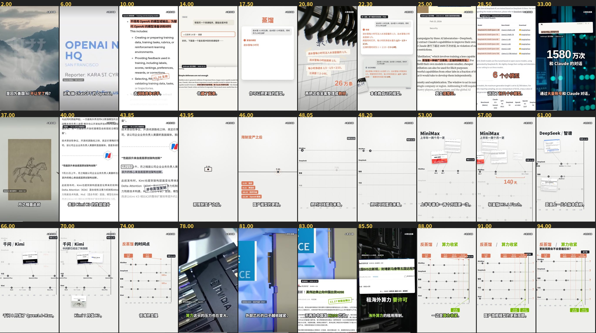

# AI来龙去脉 · 竖屏 AI 科普视频制作流程

## 项目介绍

抖音账号「AI来龙去脉」的视频制作流程：**一篇口播稿 → 一条 60–100 秒的竖屏成片**。

- 不露脸，只有配音；画面用真实素材（官方视频、新闻片段、网页原件、发布页）加自己画的信息图，**不用 AI 生成图**。
- 流程由 [Claude Code](https://claude.com/claude-code) 按 [`CLAUDE.md`](CLAUDE.md) 的规矩执行，人只在 4 个节点拍板（改不改稿、分镜、关键帧、成片）。
- 画面全是 HTML/CSS/SVG，用 Chrome 逐帧渲染，ffmpeg 合成；字幕按配音逐字对时。
- 附一期**完整范例**（第28期《国产AI，师从美国？》），脚本、分镜、配音、字幕时间轴全在，照着做能 1:1 复刻。

## 使用说明

**复刻第28期：**

```bash
git clone https://github.com/ZeroBean/ai-laimai-video-pipeline.git && cd ai-laimai-video-pipeline
pip install -r requirements.txt
cp .env.example .env && vim .env && set -a && source .env && set +a

cd examples/ep28_distill_shicong
bash tools/fetch_assets.sh                              # 下素材、截网页、装依赖、抽帧（约 10 分钟）
bash tools/build_v1.sh                                  # 渲染全片 + 合成配音（3 核约 17 分钟）
python tools/dull_scan.py 国产AI师从美国_v1.mp4           # 闷点检查，期望 DULL_SEGS 0
python tools/final_qc.py  国产AI师从美国_v1.mp4           # 字幕逐屏对时
```

仓库已附配音和字幕时间轴，不填 TTS 密钥也能跑。改了画面只补渲那几秒：`bash tools/patch.sh 43.9 48.1`。

**做新的一期：**

```bash
bash scripts/new_episode.sh ep29_xxx       # 生成 episodes/ep29_xxx/，带好全套工具
```
把口播稿贴进 `文案_用户原稿_v1.md`，在 Claude Code 里说「按 CLAUDE.md 做这一期」。
每期要重写的只有：读音表 `SAY`、字幕切屏 `SC`、`film/kit.js`（配色）、`film/shots.js`（镜头表）、`film/scenes.js`（画面）、`film/kf.js`（关键帧）。

每个脚本的用法见 [docs/04_工具说明.md](docs/04_工具说明.md)。

## 配置说明

**依赖**（括号里是作者环境的版本）：Linux，Node.js（20）、Google Chrome（153）、Python（3.9+）、ffmpeg/ffprobe（7.0.2）、yt-dlp（2026.10.26，需要 deno）、faster-whisper（1.2.1，small 模型）、中文字体 Noto Sans CJK SC。

**环境变量**（`.env.example`）：

| 变量 | 说明 |
|---|---|
| `DOUBAO_SPEECH_KEY` | 火山引擎豆包语音合成 2.0 的 Key，重新配音时才需要（音色 `zh_male_liufei_uranus_bigtts`） |
| `ARK_API_KEY` | 火山方舟 Key，用真模型实测回答时才需要 |
| `FFMPEG` `FFPROBE` `CHROME` `YTDLP` `PYTHON` | 外部程序路径，不填就用 PATH 里的 |
| `WHISPER_MODEL` | faster-whisper 模型名或本地目录，默认 `small` |
| `YT_COOKIES` | YouTube 拦机器人时用的 cookies.txt（只导出 youtube/google 域） |

**账号统一样式**：1080×1920、30fps；只有中文字幕（一屏 ≤14 字，按逗号切）；无配乐无音效；右上角角标 + 底部进度条。其余画风每期从题材重新设计，不套模板。

## 核心流程


| 步 | 做什么 | 产出 |
|---|---|---|
| ① 核稿 | 逐句查事实；用户原稿默认不改，只提大的逻辑谬误和明确事实错误 | `事实核对.md` |
| ② 配音 | 整句合成，型号数字的读法写进读音表 | `tts/` |
| ③ 分镜 | 先定核心意象、颜色、主线怎么往前走，再逐句写画面 | `分镜_v1.md` |
| ④ 素材 | 分镜过了才找；视频优先，其次网页原件、官方发布页、免费空镜 | `素材清单.md` |
| ⑤ 关键帧 | 6–8 张终稿画质，挑不同段落 | `kf/` |
| ⑥ 全片 | 逐字对时 → 字幕时间轴 → 抽帧 → 逐帧渲染 → 合成配音 | 成片 mp4 |
| ⑦ 质检 | 闷点（连续 2 秒画面不动）、字幕对时、帧数、抽帧总览 | 质检日志 |

详见 [docs/01_流程SOP.md](docs/01_流程SOP.md)；规矩见 [内容](docs/02_内容与文案规矩.md)、[画面](docs/03_画面规矩.md)、[质检](docs/05_质检.md)、[踩坑记录](docs/06_踩坑记录.md)。

## 样例

**完整范例：** [`examples/ep28_distill_shicong/`](examples/ep28_distill_shicong/)（文案 → 核对 → 分镜 → 素材清单 → 关键帧 → 成片）



**历期成片：** mp4 在 [Releases → cases-v1](../../releases/tag/cases-v1)，清单见 [`cases.tsv`](cases.tsv)。

| 期 | 标题 | 画风 |
|---|---|---|
| 28 | 国产AI，师从美国？ | 双色 + 贯穿全片的发布时间轴 |
| 27 | 你教AI那一套，其实已经过时了 | 大字压实拍 + 访谈原声 |
| 26 | DeepSeek限额，免费AI到头了 | 深色底 + 三状态色，额度条做主线 |
| 25 | DeepSeek一限额，我失恋了 | 手机界面全屏 + 深夜实拍 |
| 24 | 大反转！老黄要杀回来了 | 请愿网站真录屏 |
| 23 | 短视频算法翻车 | 新闻视频为主 |
| 19 | 免费开源才是最狠的生意 | 涂黑账单 |
| 18 | 顶尖AI人才居然被中国人包圆了 | 双色报纸 |
| 11 | AI造富有多快：五年七个百亿富豪 | 纸面桌面 |
| … | 共 23 期，见 `cases.tsv` | |

---

代码以 [MIT](LICENSE) 开源。案例成片、文案、分镜版权归「AI来龙去脉」，仅供学习交流；成片中的新闻画面、宣传片、网页截图等第三方内容版权归原权利人（来源见各期 `素材清单.md`），仓库不附带素材，如有异议请提 Issue。
