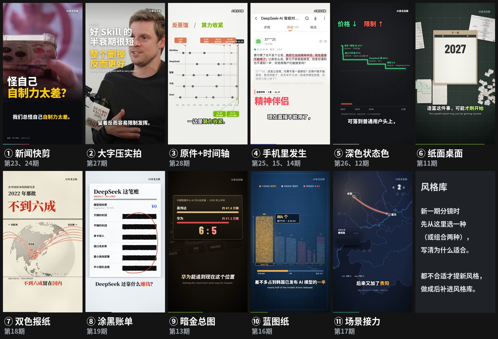
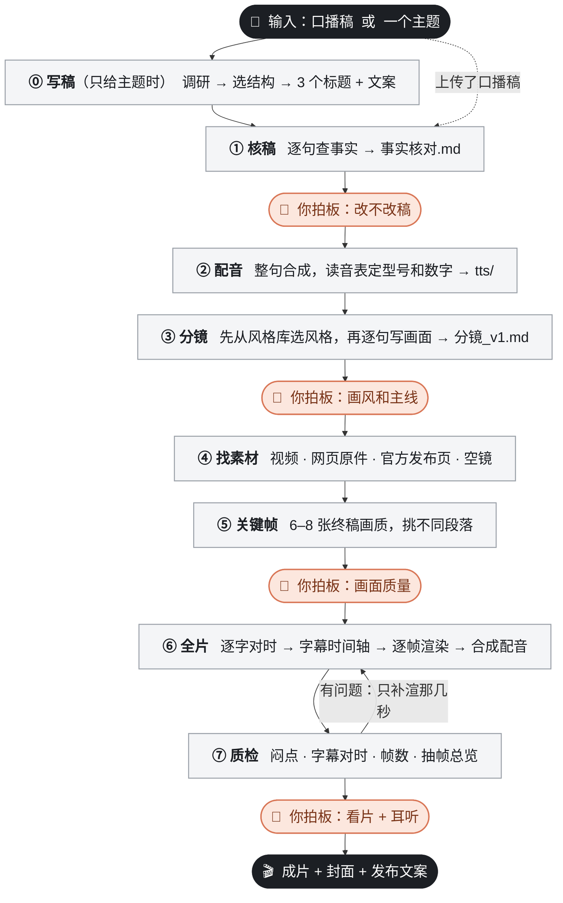
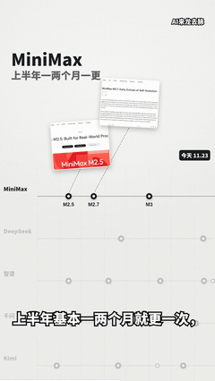
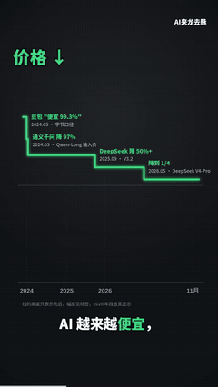
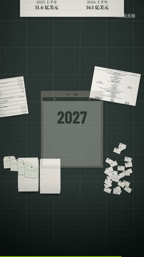
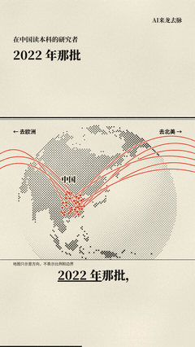
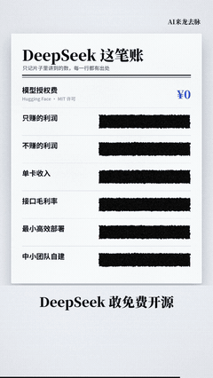
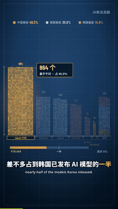
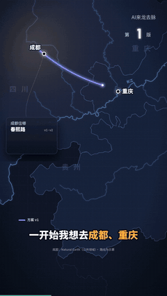

<div align="center">

# AI来龙去脉 · 竖屏 AI 科普视频制作流程

**一篇口播稿（或一个主题）→ 一条 60–100 秒的竖屏成片**

不露脸 · 只有配音 · 真实素材 + 信息图 · 不用 AI 生成图 · 任意 AI Agent 可跑

[快速开始](#快速开始) · [风格库](docs/07_风格库.md) · [案例成片](../../releases/tag/cases-v1) · [完整范例](examples/ep28_distill_shicong/)



</div>

## 目录

- [项目介绍](#项目介绍)
- [快速开始](#快速开始)
- [两种开始方式](#两种开始方式)
- [配置说明](#配置说明)
- [核心流程](#核心流程)
- [风格与样例](#风格与样例)
- [用不同的 AI Agent](#用不同的-ai-agent)
- [文档索引](#文档索引)
- [版权](#版权)

## 项目介绍

抖音账号「AI来龙去脉」的视频制作流程，已经做了 28 期。

- **人只拍板，Agent 干活**：写稿/核稿、配音、分镜、找素材、关键帧、渲染、质检都由 Agent 按 [`AGENTS.md`](AGENTS.md) 执行，人在 4 个节点拍板。
- **画面是代码**：HTML/CSS/SVG 写画面，Chrome 逐帧渲染，ffmpeg 合成；改一处只补渲那几秒。
- **字幕逐字对时**：配音逐字识别后和文案对齐，成片后再从音轨复核一遍。
- **可复刻**：附第28期完整范例，脚本、分镜、配音、字幕时间轴全在，照着跑出同一条片子。

## 快速开始

```bash
git clone https://github.com/ZeroBean/ai-laimai-video-pipeline.git && cd ai-laimai-video-pipeline
pip install -r requirements.txt
cp .env.example .env && set -a && source .env && set +a     # 按需填写，见「配置说明」

# 复刻第28期
cd examples/ep28_distill_shicong
bash tools/fetch_assets.sh                         # 下素材、截网页、抽帧（约 10 分钟）
bash tools/build_v1.sh                             # 渲染全片 + 配音（3 核约 17 分钟）
python tools/dull_scan.py 国产AI师从美国_v1.mp4      # 闷点检查，期望 DULL_SEGS 0
python tools/final_qc.py  国产AI师从美国_v1.mp4      # 字幕逐屏对时
```

> 范例已附配音和字幕时间轴，不填任何密钥也能跑通。改了画面只补渲那几秒：`bash tools/patch.sh 43.9 48.1`

## 两种开始方式

```bash
bash scripts/new_episode.sh ep29_xxx    # 新建一期，带好全套工具
```

| | 你给什么 | Agent 先做什么 |
|---|---|---|
| **A. 上传口播稿** | 写好的稿子 | 原样保存、**不改稿**，逐句核对事实后交结论给你 |
| **B. 给一个主题** | 一句话主题 / 新闻链接 | 调研 → 选结构（新闻型 / 解释型 / 方法型 / 核查型）→ 3 个标题 + 文案 v1 → 等你改稿 |

开场话术和写稿规矩见 [docs/08_文案写作.md](docs/08_文案写作.md)。

## 配置说明

**依赖**：Linux · Node.js 20 · Google Chrome · Python 3.9+ · ffmpeg 7 · yt-dlp（需要 deno）· faster-whisper · Noto Sans CJK 字体

<details>
<summary><b>环境变量（.env）</b></summary>

| 变量 | 说明 |
|---|---|
| `DOUBAO_SPEECH_KEY` | 豆包语音合成 2.0 的 Key，重新配音时才需要（音色 `zh_male_liufei_uranus_bigtts`） |
| `ARK_API_KEY` | 火山方舟 Key，用真模型实测回答时才需要 |
| `FFMPEG` `FFPROBE` `CHROME` `YTDLP` `PYTHON` | 外部程序路径，不填就用 PATH 里的 |
| `WHISPER_MODEL` | faster-whisper 模型名或本地目录，默认 `small` |
| `YT_COOKIES` | YouTube 拦机器人时用（只导出 youtube/google 域） |

</details>

<details>
<summary><b>账号统一样式</b></summary>

1080×1920 · 30fps · 只有中文字幕（一屏 ≤14 字，按逗号切）· 无配乐无音效 · 右上角角标 + 底部进度条 · 画风从[风格库](docs/07_风格库.md)按题材选

</details>

## 核心流程



<details>
<summary><b>每一步做什么、产出什么</b></summary>

| 步 | 做什么 | 产出 |
|---|---|---|
| ⓪ 写稿 | 只给主题时：调研、选结构、写 3 个标题 + 文案 | `文案_AI生成_v1.md` |
| ① 核稿 | 逐句查事实；上传的稿默认不改，只提大的逻辑谬误和明确事实错误 | `事实核对.md` |
| ② 配音 | 整句合成，型号、数字的读法写进读音表 | `tts/` |
| ③ 分镜 | 先从风格库选风格，再定配色、主线怎么往前走，逐句写画面 | `分镜_v1.md` |
| ④ 素材 | 视频优先，其次网页原件、官方发布页、免费空镜 | `素材清单.md` |
| ⑤ 关键帧 | 6–8 张终稿画质，挑不同段落 | `kf/` |
| ⑥ 全片 | 逐字对时 → 字幕时间轴 → 抽帧 → 逐帧渲染 → 合成配音 | 成片 mp4 |
| ⑦ 质检 | 闷点（连续 2 秒画面不动）、字幕对时、帧数、抽帧总览 | 质检日志 |

</details>

## 风格与样例

做过的各期归纳成 **11 种风格**。分镜时先从风格库选一种（或两种组合）；都不合适才提新风格，做成后补进库。**点动图或片名即可播放原片**（每种风格的要素、适合题材、踩过的坑 → [docs/07_风格库.md](docs/07_风格库.md)）。

<table>
<tr>
<td align="center" valign="top" width="33%"><a href="https://github.com/ZeroBean/ai-laimai-video-pipeline/releases/download/cases-v1/ep23_tiktok_rabbit_hole.mp4"></a><br><b>① 新闻快剪</b><br><sub>适合：突发新闻、人物事件</sub><br><sub><a href="https://github.com/ZeroBean/ai-laimai-video-pipeline/releases/download/cases-v1/ep23_tiktok_rabbit_hole.mp4">▶ 第23期 短视频算法翻车</a><br><a href="https://github.com/ZeroBean/ai-laimai-video-pipeline/releases/download/cases-v1/ep24_huang_comeback.mp4">▶ 第24期 大反转！老黄要杀回来了</a></sub></td>
<td align="center" valign="top" width="33%"><a href="https://github.com/ZeroBean/ai-laimai-video-pipeline/releases/download/cases-v1/ep27_prompt_outdated.mp4"></a><br><b>② 大字压实拍</b><br><sub>适合：访谈、演讲里的观点</sub><br><sub><a href="https://github.com/ZeroBean/ai-laimai-video-pipeline/releases/download/cases-v1/ep27_prompt_outdated.mp4">▶ 第27期 你教AI那一套，其实已经过时了</a></sub></td>
<td align="center" valign="top" width="33%"><a href="https://github.com/ZeroBean/ai-laimai-video-pipeline/releases/download/cases-v1/ep28_distill_shicong.mp4"></a><br><b>③ 原件 + 时间轴</b><br><sub>适合：一连串政策/事件、多家对比</sub><br><sub><a href="https://github.com/ZeroBean/ai-laimai-video-pipeline/releases/download/cases-v1/ep28_distill_shicong.mp4">▶ 第28期 国产AI，师从美国？</a></sub></td>
</tr>
<tr>
<td align="center" valign="top" width="33%"><a href="https://github.com/ZeroBean/ai-laimai-video-pipeline/releases/download/cases-v1/ep25_deepseek_shilian.mp4"></a><br><b>④ 手机里发生</b><br><sub>适合：App 限额、弹窗、AI 操作手机</sub><br><sub><a href="https://github.com/ZeroBean/ai-laimai-video-pipeline/releases/download/cases-v1/ep25_deepseek_shilian.mp4">▶ 第25期 DeepSeek一限额，我失恋了</a><br><a href="https://github.com/ZeroBean/ai-laimai-video-pipeline/releases/download/cases-v1/ep15_apple_ai_cn.mp4">▶ 第15期 苹果用户苦等2年的AI到底有什么用</a><br><a href="https://github.com/ZeroBean/ai-laimai-video-pipeline/releases/download/cases-v1/ep14_ai_waimai.mp4">▶ 第14期 让AI点个外卖为啥这么难</a></sub></td>
<td align="center" valign="top" width="33%"><a href="https://github.com/ZeroBean/ai-laimai-video-pipeline/releases/download/cases-v1/ep26_deepseek_free_end.mp4"></a><br><b>⑤ 深色状态色</b><br><sub>适合：价格、额度、收费的账</sub><br><sub><a href="https://github.com/ZeroBean/ai-laimai-video-pipeline/releases/download/cases-v1/ep26_deepseek_free_end.mp4">▶ 第26期 DeepSeek限额，免费AI到头了</a><br><a href="https://github.com/ZeroBean/ai-laimai-video-pipeline/releases/download/cases-v1/ep12_ai_free.mp4">▶ 第12期 AI这么贵，为什么我们用起来却免费</a></sub></td>
<td align="center" valign="top" width="33%"><a href="https://github.com/ZeroBean/ai-laimai-video-pipeline/releases/download/cases-v1/ep11_anthropic_s1.mp4"></a><br><b>⑥ 纸面桌面</b><br><sub>适合：主角是一份文件（招股书、财报）</sub><br><sub><a href="https://github.com/ZeroBean/ai-laimai-video-pipeline/releases/download/cases-v1/ep11_anthropic_s1.mp4">▶ 第11期 AI造富有多快：五年七个百亿富豪</a></sub></td>
</tr>
<tr>
<td align="center" valign="top" width="33%"><a href="https://github.com/ZeroBean/ai-laimai-video-pipeline/releases/download/cases-v1/ep18_ai_talent.mp4"></a><br><b>⑦ 双色报纸</b><br><sub>适合：国别对比、报告比例</sub><br><sub><a href="https://github.com/ZeroBean/ai-laimai-video-pipeline/releases/download/cases-v1/ep18_ai_talent.mp4">▶ 第18期 顶尖AI人才居然被中国人包圆了</a></sub></td>
<td align="center" valign="top" width="33%"><a href="https://github.com/ZeroBean/ai-laimai-video-pipeline/releases/download/cases-v1/ep19_free_opensource.mp4"></a><br><b>⑧ 涂黑账单</b><br><sub>适合：算账、揭成本</sub><br><sub><a href="https://github.com/ZeroBean/ai-laimai-video-pipeline/releases/download/cases-v1/ep19_free_opensource.mp4">▶ 第19期 免费开源才是最狠的生意</a></sub></td>
<td align="center" valign="top" width="33%"><a href="https://github.com/ZeroBean/ai-laimai-video-pipeline/releases/download/cases-v1/ep13_huawei_ascend.mp4"></a><br><b>⑨ 暗金总图</b><br><sub>适合：产业链、结构全景</sub><br><sub><a href="https://github.com/ZeroBean/ai-laimai-video-pipeline/releases/download/cases-v1/ep13_huawei_ascend.mp4">▶ 第13期 华为AI芯片凭什么撑起半边天</a></sub></td>
</tr>
<tr>
<td align="center" valign="top" width="33%"><a href="https://github.com/ZeroBean/ai-laimai-video-pipeline/releases/download/cases-v1/ep16_korea_qwen.mp4"></a><br><b>⑩ 蓝图纸</b><br><sub>适合：模型族谱、技术谱系</sub><br><sub><a href="https://github.com/ZeroBean/ai-laimai-video-pipeline/releases/download/cases-v1/ep16_korea_qwen.mp4">▶ 第16期 韩国AI的半壁江山用的是中国模型</a></sub></td>
<td align="center" valign="top" width="33%"><a href="https://github.com/ZeroBean/ai-laimai-video-pipeline/releases/download/cases-v1/ep17_ai_yueliaoyueben.mp4"></a><br><b>⑪ 场景接力</b><br><sub>适合：过程类、变化类（可组合）</sub><br><sub><a href="https://github.com/ZeroBean/ai-laimai-video-pipeline/releases/download/cases-v1/ep17_ai_yueliaoyueben.mp4">▶ 第17期 AI越聊越笨，真不是你的错觉</a></sub></td>
</tr>
</table>

<details>
<summary><b>全部 23 期原片 · 风格对应表</b></summary>

| 期 | 标题 | 风格 | 时长 | 原片 |
|---|---|---|---|---|
| 第2期 | ChatGPT是怎么来的 | 早期 | 231s | [▶ 播放 / 下载](https://github.com/ZeroBean/ai-laimai-video-pipeline/releases/download/cases-v1/ep02_chatgpt.mp4) |
| 第2期（短版） | ChatGPT的核心原理（短版） | 早期 | 100s | [▶ 播放 / 下载](https://github.com/ZeroBean/ai-laimai-video-pipeline/releases/download/cases-v1/ep02_short.mp4) |
| 第3期 | 特斯拉Roadster倒挂翻身原理 | 早期（汽车题材试验） | 92s | [▶ 播放 / 下载](https://github.com/ZeroBean/ai-laimai-video-pipeline/releases/download/cases-v1/ep03_roadster.mp4) |
| 第4期 | DeepSeek淘汰线 | 已停用·意象比喻（对战 HUD） | 70s | [▶ 播放 / 下载](https://github.com/ZeroBean/ai-laimai-video-pipeline/releases/download/cases-v1/ep04_deepseek.mp4) |
| 第5期 | DeepSeek只用3%的脑子 | 已停用·像素/AI 生成图 | 70s | [▶ 播放 / 下载](https://github.com/ZeroBean/ai-laimai-video-pipeline/releases/download/cases-v1/ep05_moe.mp4) |
| 第7期 | DeepSeek公开自家印钞机 | 已停用·意象比喻（小票机） | 59s | [▶ 播放 / 下载](https://github.com/ZeroBean/ai-laimai-video-pipeline/releases/download/cases-v1/ep07_deepseek_open.mp4) |
| 第9期 | 蔚来融资十余年不如DeepSeek一轮 | 已停用·意象比喻（资金柱） | 78s | [▶ 播放 / 下载](https://github.com/ZeroBean/ai-laimai-video-pipeline/releases/download/cases-v1/ep09_deepseek_funding.mp4) |
| 第10期 | AI竞争只剩中美，欧洲日本去哪了 | 已停用·意象比喻（牌桌） | 93s | [▶ 播放 / 下载](https://github.com/ZeroBean/ai-laimai-video-pipeline/releases/download/cases-v1/ep10_eu_japan.mp4) |
| 第11期 | AI造富有多快：五年七个百亿富豪 | ⑥ 纸面桌面 | 69s | [▶ 播放 / 下载](https://github.com/ZeroBean/ai-laimai-video-pipeline/releases/download/cases-v1/ep11_anthropic_s1.mp4) |
| 第12期 | AI这么贵，为什么我们用起来却免费 | ⑤ 深色状态色 | 68s | [▶ 播放 / 下载](https://github.com/ZeroBean/ai-laimai-video-pipeline/releases/download/cases-v1/ep12_ai_free.mp4) |
| 第13期 | 华为AI芯片凭什么撑起半边天 | ⑨ 暗金总图 | 94s | [▶ 播放 / 下载](https://github.com/ZeroBean/ai-laimai-video-pipeline/releases/download/cases-v1/ep13_huawei_ascend.mp4) |
| 第14期 | 让AI点个外卖为啥这么难 | ④ 手机里发生 | 91s | [▶ 播放 / 下载](https://github.com/ZeroBean/ai-laimai-video-pipeline/releases/download/cases-v1/ep14_ai_waimai.mp4) |
| 第15期 | 苹果用户苦等2年的AI到底有什么用 | ④ 手机里发生 | 73s | [▶ 播放 / 下载](https://github.com/ZeroBean/ai-laimai-video-pipeline/releases/download/cases-v1/ep15_apple_ai_cn.mp4) |
| 第16期 | 韩国AI的半壁江山用的是中国模型 | ⑩ 蓝图纸 | 79s | [▶ 播放 / 下载](https://github.com/ZeroBean/ai-laimai-video-pipeline/releases/download/cases-v1/ep16_korea_qwen.mp4) |
| 第17期 | AI越聊越笨，真不是你的错觉 | ⑪ 场景接力 | 91s | [▶ 播放 / 下载](https://github.com/ZeroBean/ai-laimai-video-pipeline/releases/download/cases-v1/ep17_ai_yueliaoyueben.mp4) |
| 第18期 | 顶尖AI人才居然被中国人包圆了 | ⑦ 双色报纸 | 103s | [▶ 播放 / 下载](https://github.com/ZeroBean/ai-laimai-video-pipeline/releases/download/cases-v1/ep18_ai_talent.mp4) |
| 第19期 | 免费开源才是最狠的生意 | ⑧ 涂黑账单 | 92s | [▶ 播放 / 下载](https://github.com/ZeroBean/ai-laimai-video-pipeline/releases/download/cases-v1/ep19_free_opensource.mp4) |
| 第23期 | 短视频算法翻车 | ① 新闻快剪 | 71s | [▶ 播放 / 下载](https://github.com/ZeroBean/ai-laimai-video-pipeline/releases/download/cases-v1/ep23_tiktok_rabbit_hole.mp4) |
| 第24期 | 大反转！老黄要杀回来了 | ① 新闻快剪 | 86s | [▶ 播放 / 下载](https://github.com/ZeroBean/ai-laimai-video-pipeline/releases/download/cases-v1/ep24_huang_comeback.mp4) |
| 第25期 | DeepSeek一限额，我失恋了 | ④ 手机里发生 | 79s | [▶ 播放 / 下载](https://github.com/ZeroBean/ai-laimai-video-pipeline/releases/download/cases-v1/ep25_deepseek_shilian.mp4) |
| 第26期 | DeepSeek限额，免费AI到头了 | ⑤ 深色状态色 | 86s | [▶ 播放 / 下载](https://github.com/ZeroBean/ai-laimai-video-pipeline/releases/download/cases-v1/ep26_deepseek_free_end.mp4) |
| 第27期 | 你教AI那一套，其实已经过时了 | ② 大字压实拍 | 88s | [▶ 播放 / 下载](https://github.com/ZeroBean/ai-laimai-video-pipeline/releases/download/cases-v1/ep27_prompt_outdated.mp4) |
| 第28期 | 国产AI，师从美国？ | ③ 原件+时间轴 | 95s | [▶ 播放 / 下载](https://github.com/ZeroBean/ai-laimai-video-pipeline/releases/download/cases-v1/ep28_distill_shicong.mp4) |

> 第 20–22 期涉及个人隐私，未公开。完整清单见 [`cases.tsv`](cases.tsv)，打包下载见 [Releases · cases-v1](../../releases/tag/cases-v1)。

</details>

**完整范例**：[`examples/ep28_distill_shicong/`](examples/ep28_distill_shicong/)（风格 ③，文案 → 核对 → 分镜 → 素材清单 → 关键帧 → 成片）

## 用不同的 AI Agent

规矩只写在 [`AGENTS.md`](AGENTS.md) 一份，`bash scripts/sync_rules.sh` 生成各家的规矩文件：

| Agent | 读取的规矩文件 | 启动 |
|---|---|---|
| Claude Code | `CLAUDE.md` | `claude` |
| OpenAI Codex CLI | `AGENTS.md` | `codex` |
| Gemini CLI | `GEMINI.md` | `gemini` |
| Cursor | `.cursor/rules/ai-laimai.mdc` | Agent 模式 |
| Aider / 其他 | `AGENTS.md` | `aider --read AGENTS.md` / 开场让它先读 |

Agent 至少要能执行命令、读写文件；不能联网或不能看图也能跑，缺什么由人补。详见 [docs/09_其他Agent使用.md](docs/09_其他Agent使用.md)。

## 文档索引

| 文档 | 内容 |
|---|---|
| [01 流程SOP](docs/01_流程SOP.md) | 每一步的输入、输出、谁拍板、怎么验收 |
| [02 内容与文案规矩](docs/02_内容与文案规矩.md) | 选题、口吻、尊重原稿、逻辑体检 |
| [03 画面规矩](docs/03_画面规矩.md) | 真实素材、主线过渡、不要的东西 |
| [04 工具说明](docs/04_工具说明.md) | 每个脚本的用法和输出 |
| [05 质检](docs/05_质检.md) | 闷点、字幕对时、帧数、抽帧总览 |
| [06 踩坑记录](docs/06_踩坑记录.md) | 下载、截图、编码的坑 |
| [07 风格库](docs/07_风格库.md) | 11 种风格 + 代表视频 |
| [08 文案写作](docs/08_文案写作.md) | 上传稿 / 给主题自动写稿 |
| [09 其他 Agent](docs/09_其他Agent使用.md) | Codex、Gemini、Cursor 等的用法 |

## 版权

代码以 [MIT](LICENSE) 开源。案例成片、文案、分镜版权归「AI来龙去脉」，仅供学习交流。成片中的新闻画面、宣传片、网页截图等第三方内容版权归原权利人（来源见各期 `素材清单.md`）；仓库不附带素材，如有异议请提 Issue。
