# 07 风格库

这 11 种风格都是做过、用户看过、成片发过的。**新一期分镜时先从这里选一种（或两种组合）**，写清为什么适合这期题材；都不合适才提新风格（出 2–3 版关键帧对比给用户选），新风格做成后补进这里。

选了风格不等于照抄：配色、主线物件、意象从这期题材里取（同一种风格连续两期用，要换配色和主线物件，第25、26期同新闻隔天发就是刻意错开的）。

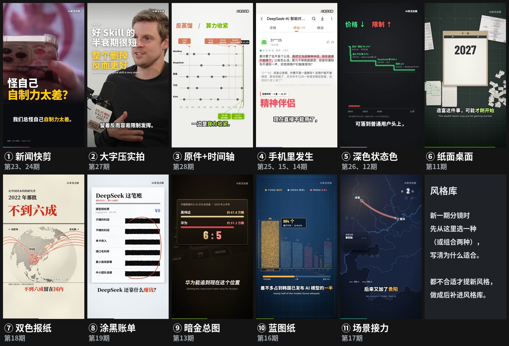

## 怎么选

| 题材的样子 | 优先考虑 |
|---|---|
| 新闻事件，有大量新闻视频、现场画面 | ① 新闻快剪 |
| 有访谈、演讲、播客原声，观点类 | ② 大字压实拍 |
| 政策/指控/回应一连串事件，多家对比，讲先后 | ③ 原件+时间轴 |
| 事情本身发生在 App 里（弹窗、评论、限额、AI 操作手机） | ④ 手机里发生 |
| 讲行业的账：价格、额度、收费，几种状态来回变 | ⑤ 深色状态色 |
| 主角是一份文件（招股书、财报、报告），钱还在纸上 | ⑥ 纸面桌面 |
| 国别对比、研究报告里的比例数据 | ⑦ 双色报纸 |
| 主干是算账、揭成本，一项项讲清 | ⑧ 涂黑账单 |
| 产业链 / 结构全景，层层往下钻 | ⑨ 暗金总图 |
| 模型族谱、技术谱系、"谁基于谁" | ⑩ 蓝图纸 |
| 一件事要经历好几个阶段，同一种界面撑不住 | ⑪ 场景接力（可以和其他风格组合） |

---

## ① 新闻快剪
 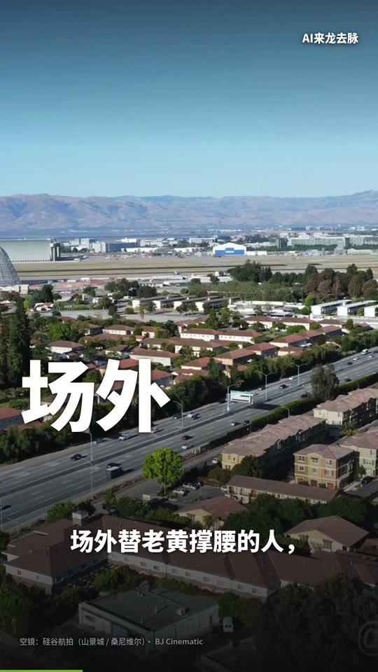

- **一句话**：新闻视频为主，平均 2–3 秒一切，超大白字 + 一个色的关键词直接压在会动的画面上。
- **要素**：深色底；全屏竖切和 4:5 窗口（横版完整 + 上下虚化填充）交替；标注（日期、来源、数字）压在画面上，不单独做卡片页；照片只在没视频时用，一张 ≤1 秒、成组连切；段落之间用空镜接。
- **适合**：突发新闻、人物事件、有大量新闻视频的题材。
- **不适合**：没有视频素材、需要讲清原理的题材。
- **代表**：第23期《短视频算法翻车》（[mp4](https://github.com/ZeroBean/ai-laimai-video-pipeline/releases/download/cases-v1/ep23_tiktok_rabbit_hole.mp4)）、第24期《大反转！老黄要杀回来了》（[mp4](https://github.com/ZeroBean/ai-laimai-video-pipeline/releases/download/cases-v1/ep24_huang_comeback.mp4)，场外 → 场内主线 + 请愿网站真录屏）。
- **注意**：新闻片里的台标、记者字卡、滚动条要裁掉或换入点；总览图时间标可能比实际早 1–1.5 秒，取入点要抽帧核。

## ② 大字压实拍
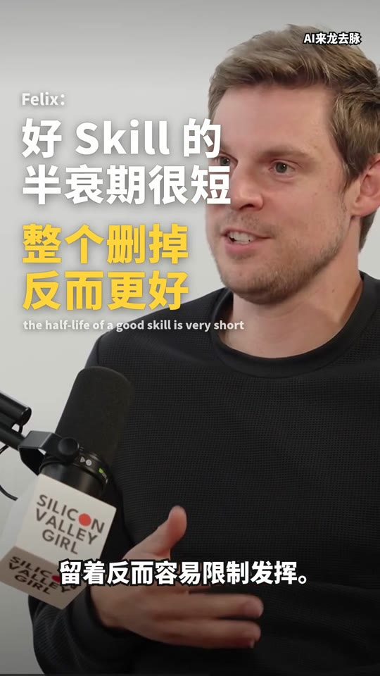

- **一句话**：满屏实拍（访谈、空镜、真网页），一屏只压一句超大字 + 大数字，红笔划线。
- **要素**：演播室浅灰白；人名条（姓名 + 头衔）；原声插入 2 处左右（响度对齐配音）；英文原话就地换中文。
- **适合**：访谈、演讲、播客里的观点和方法。
- **不适合**：数据密集、要对比很多对象的题材。
- **代表**：第27期《你教AI那一套，其实已经过时了》（[mp4](https://github.com/ZeroBean/ai-laimai-video-pipeline/releases/download/cases-v1/ep27_prompt_outdated.mp4)）。
- **注意**：这一风格是从 A（浅灰底 + 白色对话卡）被评"很素、密密麻麻的文字"后改来的：界面类别把整段回复铺满屏，挑一句原话或一个数字放大。

## ③ 原件 + 时间轴
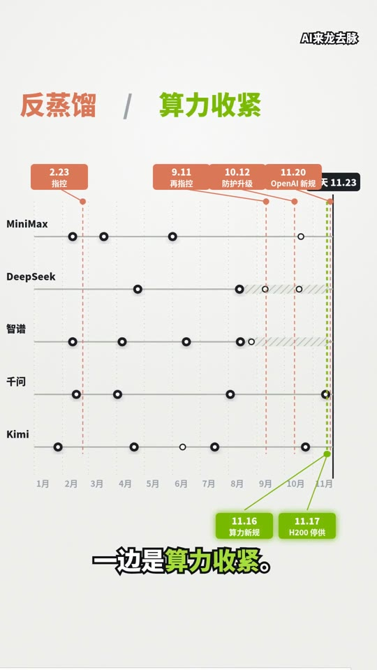 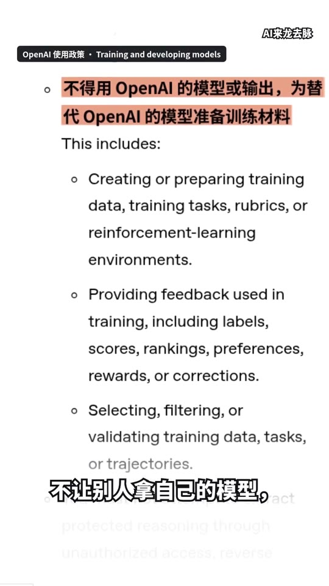

- **一句话**：亮底，真网页原件满屏（原句就地中文高亮），一根时间轴从某条新闻的日期里长出来，贯穿后半段。
- **要素**：颜色直接取"压力来源"的品牌色（克劳德橙 = 反蒸馏、英伟达绿 = 算力）；时间轴上发布点挂官方发布页截图；"还在等"用斜纹空白画到今天；时间轴最多出现 2 次，镜头沿轴移动而不是静图换高亮。
- **适合**：政策、指控、回应一连串事件；多家公司对比；"到底慢没慢 / 多不多"这类要摆时间线的问题。
- **不适合**：单一事件、没有时间维度的题材。
- **代表**：第28期《国产AI，师从美国？》（[mp4](https://github.com/ZeroBean/ai-laimai-video-pipeline/releases/download/cases-v1/ep28_distill_shicong.mp4)，本仓库完整范例）。
- **注意**：时间轴画到"今天"，空白段才站得住；不要把可能产生暗示的两件事并排放。

## ④ 手机里发生
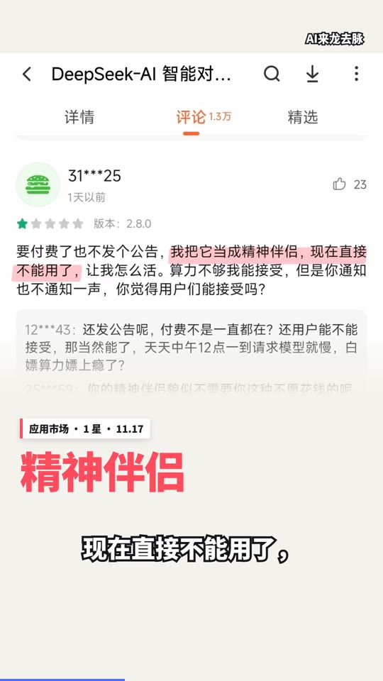 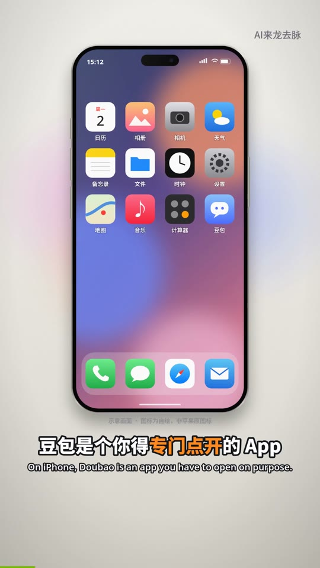 

- **一句话**：事情本身发生在手机里，就让手机做主舞台。三种做法：界面全屏铺满（第25期）、影棚里一部仿真 iPhone 一路切 App（第15期）、手机 + 暖白桌面上的报道原件（第14期）。
- **要素**：界面照真截图一字不改、角落标「界面示意」；评论、热搜用真截图；平台用文字名牌不用 logo；中间用实拍空镜 / 机房隔开，手机界面合计 ≤40% 时长。
- **适合**：App 限额、弹窗、评论区、AI 替你操作手机、手机功能评测。
- **不适合**：和具体 App 无关的行业话题。
- **代表**：第25期《DeepSeek一限额，我失恋了》（[mp4](https://github.com/ZeroBean/ai-laimai-video-pipeline/releases/download/cases-v1/ep25_deepseek_shilian.mp4)）、第15期《苹果用户苦等2年的AI到底有什么用》（[mp4](https://github.com/ZeroBean/ai-laimai-video-pipeline/releases/download/cases-v1/ep15_apple_ai_cn.mp4)）、第14期《让AI点个外卖为啥这么难》（[mp4](https://github.com/ZeroBean/ai-laimai-video-pipeline/releases/download/cases-v1/ep14_ai_waimai.mp4)）。
- **注意**：不做绿幕抠像（第25期被评"好奇怪"）；全片都是同一个聊天窗口会单调（第17期 v1 教训）。

## ⑤ 深色状态色
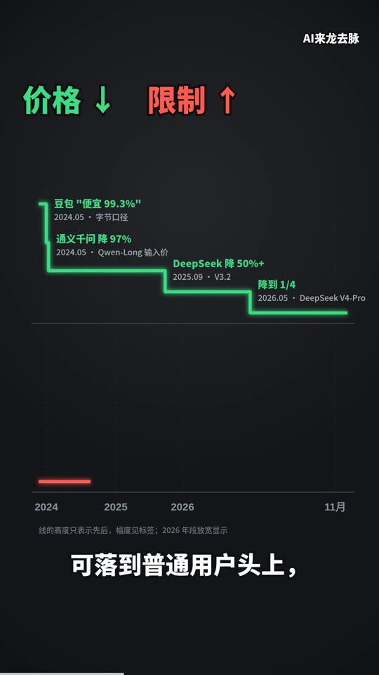 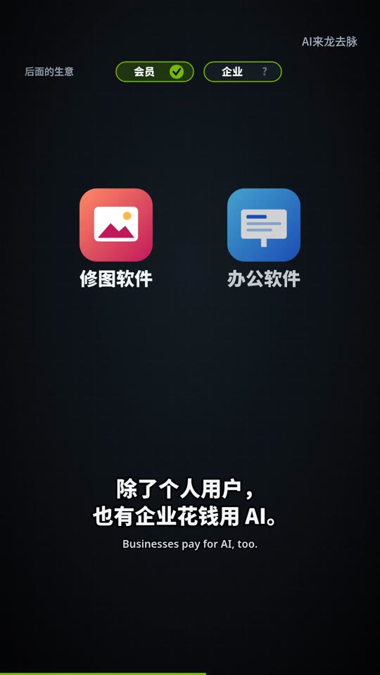

- **一句话**：深石墨底，只用 2–3 种状态色，每次出现都对应一种状态，观众看几次自己就能读出来；一个真实物件（额度条）当主线。
- **要素**：免费绿 / 付费金 / 受限红；手机界面不全屏，缩在窗口或并排几块屏；全片唯一的大信息图是"两根线"。
- **适合**：价格、额度、收费、限流这类"行业的账"。
- **不适合**：人物、事件叙事。
- **代表**：第26期《DeepSeek限额，免费AI到头了》（[mp4](https://github.com/ZeroBean/ai-laimai-video-pipeline/releases/download/cases-v1/ep26_deepseek_free_end.mp4)）、第12期《AI这么贵，为什么我们用起来却免费》（[mp4](https://github.com/ZeroBean/ai-laimai-video-pipeline/releases/download/cases-v1/ep12_ai_free.mp4)，深色底 + 真实素材卡 + 推近/荧光笔/圈框/计数）。
- **注意**：不要全片压暗、不要 PPT 式居中卡片；数据尽量落在真实界面上。

## ⑥ 纸面桌面
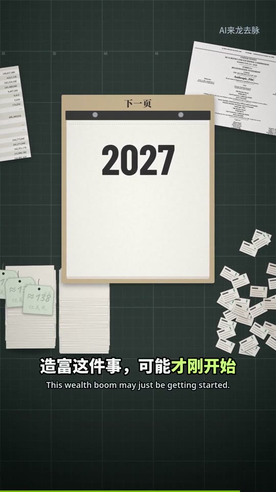

- **一句话**：俯拍一张设计师桌面，整片都是纸：撕页台历是时间，招股书的行是财富，剪报是证据。
- **要素**：深墨绿切割垫 + 网格当尺子；纸张亮、满、柔和落地阴影；三种笔迹三种可信度（钢笔 = 文件原文、红笔 = 批注、铅笔 = 估算/传闻）；撕、翻、堆、盖章、圈。
- **适合**：主角是一份文件（S-1、财报、研究报告），"钱还在纸上"。
- **不适合**：需要大量视频的新闻。
- **代表**：第11期《AI造富有多快：五年七个百亿富豪》（[mp4](https://github.com/ZeroBean/ai-laimai-video-pipeline/releases/download/cases-v1/ep11_anthropic_s1.mp4)）。

## ⑦ 双色报纸
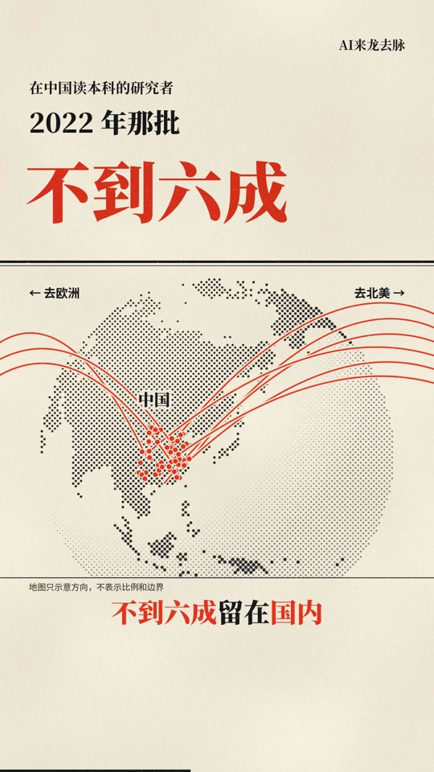

- **一句话**：暖白新闻纸 + 三色油墨（朱红 = 中国、蓝 = 美国、黑 = 其他），照片一律网点印刷。
- **要素**：Noto Serif SC 标题、Abril Fatface 大数字；整齐版面 + 竖排人名；地图用网点画陆地、不画国界。
- **硬规矩**：网点和点阵**不缩放**（手机转码会摩尔纹）；照片入场用"网点长出来"（墨量 0→100%）；动感来自点亮、描线、计数、盖章、整版换页，不靠推拉。
- **适合**：国别对比、研究报告里的比例。
- **代表**：第18期《顶尖AI人才居然被中国人包圆了》（[mp4](https://github.com/ZeroBean/ai-laimai-video-pipeline/releases/download/cases-v1/ep18_ai_talent.mp4)）。

## ⑧ 涂黑账单
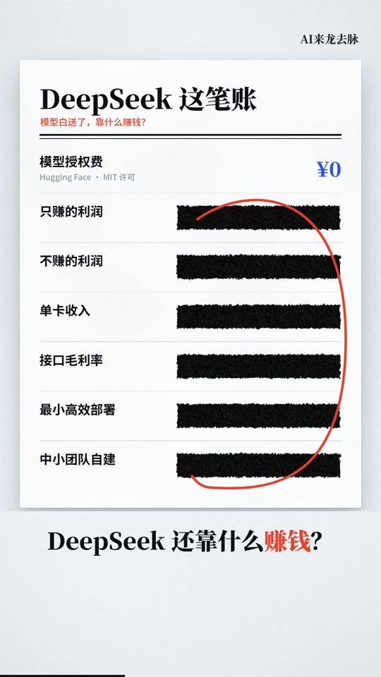

- **一句话**：开头一整张账全涂黑，每讲清一件事揭开一行，结尾全部揭开。
- **要素**：冷白纸 + 黑条；思源宋体标题 + 思源黑体正文 + 等宽数字；账上每一行都是片子里讲到的真实数字（不是比喻）；账单母版只出现 3 次（开头、中段、结尾），其余是证据原件（模型页、价格页、原文报道）。
- **适合**：算账、揭成本、"它靠什么赚钱"。
- **代表**：第19期《免费开源才是最狠的生意》（[mp4](https://github.com/ZeroBean/ai-laimai-video-pipeline/releases/download/cases-v1/ep19_free_opensource.mp4)）。

## ⑨ 暗金总图
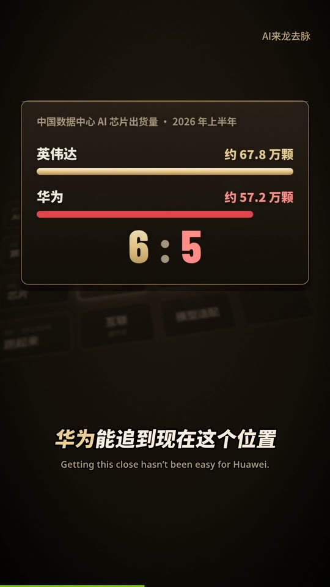

- **一句话**：一张倾斜透视的产业链总图，金色走线带着镜头一层层往下钻。
- **要素**：近黑暖棕底 + 香槟金细线 + 米白字；红色只给"出口管制 / 落后一代"；深色圆角数据卡 + 金边 + 大号香槟金数字；真实照片去色压暗当背景。
- **适合**：产业链、算力链、结构全景。
- **代表**：第13期《华为AI芯片凭什么撑起半边天》（[mp4](https://github.com/ZeroBean/ai-laimai-video-pipeline/releases/download/cases-v1/ep13_huawei_ascend.mp4)）。
- **注意**：这期被评"总是停留在第0帧的画面上，没有主线过渡感"。用这个风格时总图最多出现 2–3 次，每段要带到一个新画面。

## ⑩ 蓝图纸
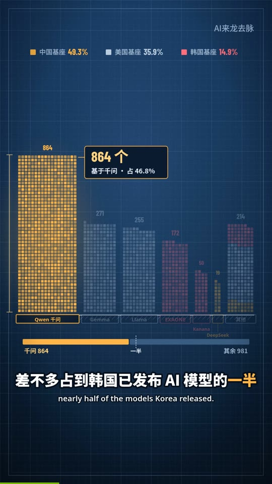

- **一句话**：深普鲁士蓝底 + 细白网格，图表用白色细线勾，配工程图式的尺寸标注和编号；新闻和官方截图像钉在图纸上的白卡片。
- **要素**：#0E2744 → #091A30；点阵柱状图；国家用色块区分；族谱图只出现 3 次。
- **适合**：模型族谱、"谁基于谁"、技术谱系。
- **代表**：第16期《韩国AI的半壁江山用的是中国模型》（[mp4](https://github.com/ZeroBean/ai-laimai-video-pipeline/releases/download/cases-v1/ep16_korea_qwen.mp4)）。

## ⑪ 场景接力
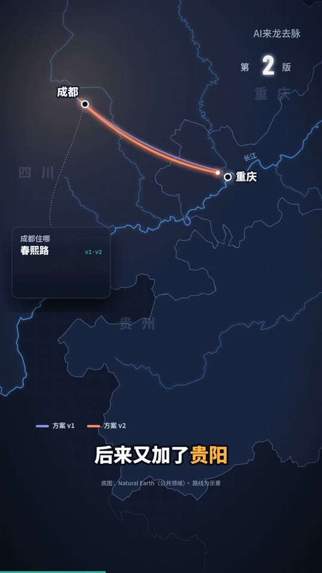

- **一句话**：一件事经历好几个阶段，每一大段换一种画面语言（窗口特写 → 论文纸 → 真实地图 → 原始文本墙 → 刻度尺 → 新窗口 → 便签），段与段之间都"带"过去。
- **要素**：同一种界面最多占 30% 时长；转场用"上一个画面里的一个元素变成下一个画面"（数据卡上的字放大成地图上的路线）。
- **适合**：过程类、"越来越 xx"的变化类题材；可以和其他风格组合。
- **代表**：第17期《AI越聊越笨，真不是你的错觉》（[mp4](https://github.com/ZeroBean/ai-laimai-video-pipeline/releases/download/cases-v1/ep17_ai_yueliaoyueben.mp4)）。

---

## 已停用的做法（别再用）

| 做法 | 出现在 | 为什么停 |
|---|---|---|
| 意象比喻搭成一个"世界"（小票机、资金柱、牌桌、对战 HUD、医院大楼） | 第4、5、7、9、10期 | 观众要多翻译一步，组件从零画、耗时长；第12期起用户定"不用意象比喻，真实图片 + 动效讲清楚"。比喻只允许用真实小物件，且要先征得同意（第28期练习册） |
| AI 生成的写实图 / 像素风 | 第5期 | "AI 味太重""取巧、成片质量太差"；不用 AI 生成图 |
| 小Lin式白板 / 光标讲解 / 白卡 | 第19期试验稿 | "卡片太像 PPT""光标太奇怪""越做越差" |
